<p align="center">
  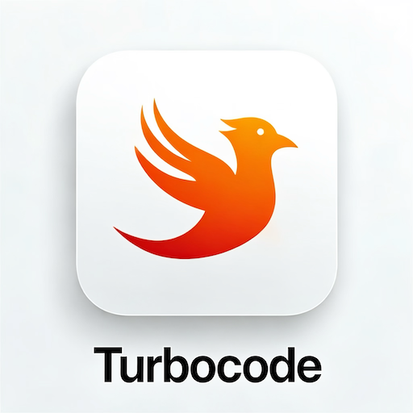
</p>

# TurboCode

## Install with Homebrew

To install TurboCode:

```shell
brew install --cask granvalenti76/homebrew-tap/turbocode
```

To update an existing installation:

```shell
brew upgrade --cask turbocode
```

To uninstall TurboCode:

```shell
brew uninstall --cask turbocode
```

The distributed application is ad-hoc signed and is not notarized by Apple.
If macOS blocks the first launch, approve TurboCode in **System Settings →
Privacy & Security**, or open the application once with **right-click → Open**.

### First launch

On first launch TurboCode looks for a model server on your Mac and on the
local network, reads the context window and checks tool calls and vision, then
writes `~/.turbocode/models.json`. Every value stays editable in Settings.

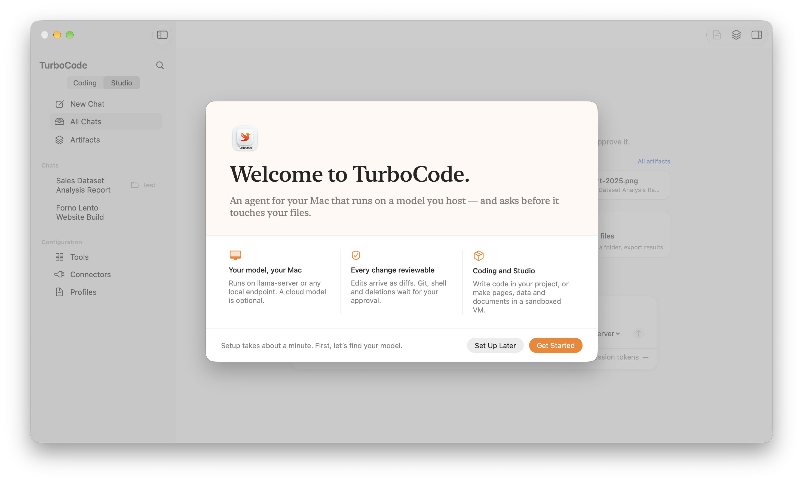

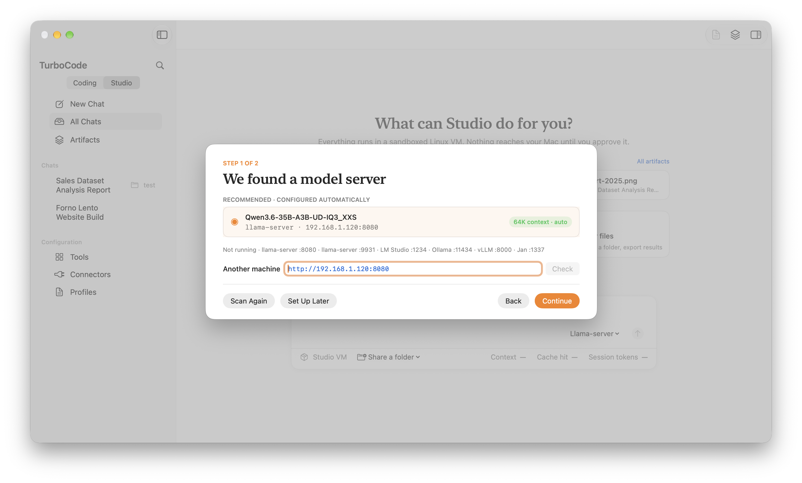

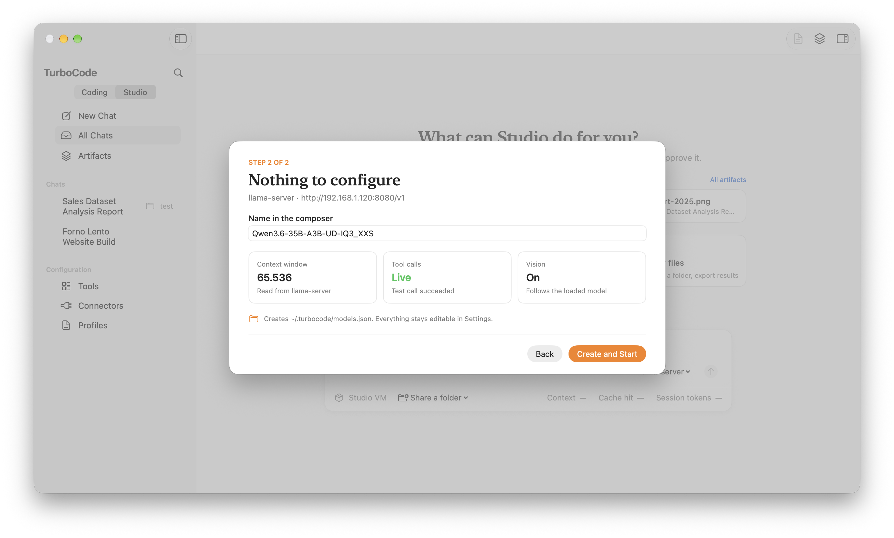

## What is TurboCode?

TurboCode is a compact, fast agent harness for macOS, written in Swift and
SwiftUI. It is built for people who want to do real agentic work with a local
model: an agent for your Mac that runs on a model you host, and asks before it
touches your files.

It has two modes. **Coding** works in a real repository, with native tools for
Swift, SwiftUI, Xcode, Swift Package Manager, and Git. **Studio** builds web
pages, scripts, data, and documents inside a sandboxed Linux VM, and nothing
reaches your Mac until you approve it.

The core agent toolchain has no JavaScript or TypeScript runtime. Model
interaction, typed tool calls, routing, context management, workspace access,
and safety boundaries are implemented with SwiftUI, AppKit, and Apple's
Foundation Models framework. Optional TypeScript plugins run separately as
Node.js processes and are not part of the core runtime.

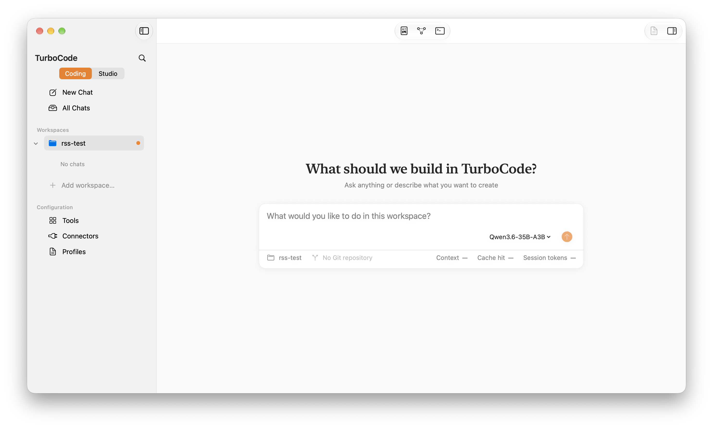

## Local-first by design

TurboCode is designed around a local model, not as a fallback for one. The
recommended setup is `llama-server` serving a MoE model such as
Qwen3.6-35B-A3B, which gives an excellent experience. Use a server on your Mac
or on your local network whenever you can; the first-launch setup finds it and
configures it for you.

Apple's on-device model is an invisible part of the product. It turns your
first prompt into the session title, and while the main model is still working
you can ask how it is going: the on-device model answers with a live summary
of what is happening, without interrupting the run.

When a task needs more capability, a session can use Codex or DeepSeek through
the supported adapters.

TurboCode is designed to remain lightweight: normal idle memory usage is kept
below 200 MB so the app can stay open alongside Xcode, simulators, and other
development tools.

## Supported model backends

TurboCode presents different model runtimes through one workbench. The model
provider changes, but the workspace, transcript, tools, approvals, and review
workflow remain inside TurboCode.

| Backend | Use | Setup |
| --- | --- | --- |
| **Apple on-device** | Local model for short answers and small agentic tasks. | No server or API key required. The available context is approximately 8k tokens. |
| **Local Llama** | Recommended backend for agentic work. | Start `llama-server`, or another OpenAI-compatible server; the first-launch setup detects it and writes the configuration. |
| **OpenAI Codex** | Frontier model accessed through the official Codex CLI App Server. | Install Codex on the system and complete the first sign-in through the browser. |
| **DeepSeek API** | Remote provider for tasks that need a frontier model. | Add the API key in **Settings → Providers**. It is stored in the macOS Keychain. |

For remote and frontier inference, the current supported adapters are OpenAI
Codex and DeepSeek. Additional third-party adapters may be added in the
future without changing the workspace and tool model.

Apple Private Cloud Compute through `fm serve` remains a legacy compatibility
path. It is not exposed as a selectable default backend.

## Studio

Studio is a second, peer mode for work beyond Swift development: React and
other web apps, Python scripts, documents, rendered pages, and screenshots. It
runs in an isolated Debian 12 Linux VM managed by TurboCode through Apple
Containerization, with Node.js 24, Python 3.11, headless Chromium, and common
command-line tools.

- Enable it in **Settings › Studio**; the first installation downloads about
  760 MB, uses about 2.2 GB, and verifies the guest with a self-test.
- Switch between **Coding** and **Studio** at the top of the sidebar.
- Share one Mac folder per session from the toolbar; the VM can read it but
  never change it.
- The agent places results in `/out`. **Review & Export** lists every file,
  shows diffs for conflicts, and copies only what you approve. Exported files
  are not executable and carry the macOS quarantine attribute.
- Commands never fall back to the Mac shell, and no credentials or Mac
  environment variables enter the VM. Codex is not available in Studio.

A new Studio session opens on a home view with capability cards and the most
recent artifacts. A card writes a starter prompt into the composer; an artifact
opens the session that made it.

- **Artifacts** in the sidebar collects what every session placed in `/out`,
  one card per session, with a thumbnail and a full-size preview of its files.
  Previews only read the outbox; copying to the Mac still goes through
  **Review & Export**.
- The Artifacts inspector beside the chat shows the session's files and opens
  servers the agent left running in the VM as a live page. A server must listen
  on `0.0.0.0` to be reachable from the Mac.
- Models with vision can look at images inside the VM, such as a screenshot of
  a page they just built.

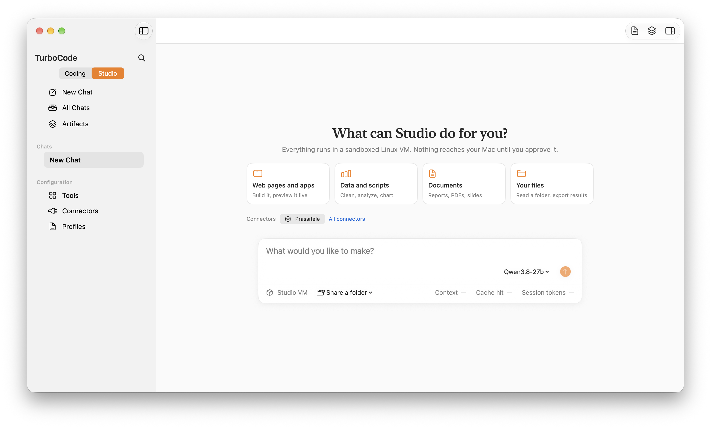

<table>
  <tr>
    <td width="50%">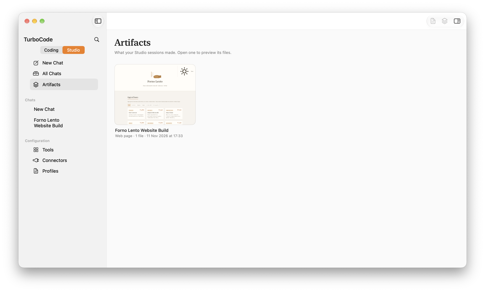</td>
    <td width="50%">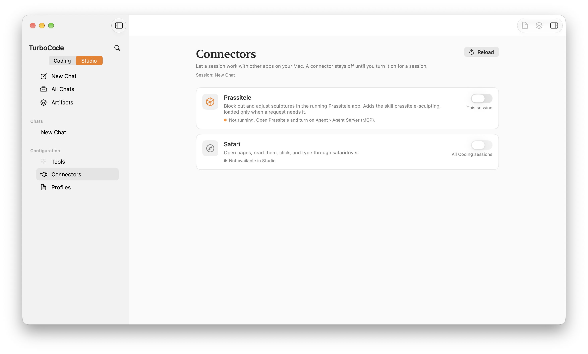</td>
  </tr>
</table>

### Connectors

A connector lets a session work with another app on your Mac through that app's
own MCP server on `127.0.0.1`. Connectors are off by default and are enabled
one session at a time from **Connectors** in the sidebar or from the Studio
home; enabling one is the consent for its calls. Delegated workers and Codex
never receive them.

- **Prassitele** blocks out and adjusts sculptures in the running Prassitele
  app. Its rendered views reach models with vision, and it adds the
  `prassitele-sculpting` skill, loaded only when a request needs it.
- **Safari** opens pages, reads them, clicks, and types through `safaridriver`.
  It is available in Coding sessions only and has a single switch for all of
  them, shown on the Connectors page and in **Settings → Agents**.

See [CONFIGURATION.md](CONFIGURATION.md#studio) for Studio settings and files,
and [Connectors](CONFIGURATION.md#connectors) for the connector catalog.

## How a TurboCode session works

TurboCode keeps the conversation connected to the real development task:

1. You select a workspace and describe an outcome.
2. The active model reads the context allowed by the current profile.
3. Structured tools inspect files, repositories, projects, tests, and
   diagnostics.
4. Changes remain revision-aware and reviewable before they are applied.
5. The resulting transcript, tool activity, and session state can be restored
   later.

A session can also delegate a self-contained subtask to a worker model
(**Coordinator → Worker**). TurboCode tracks the delegated work, keeps the
worker inside its configured boundaries, and verifies the result before
returning it to the conversation. Most sessions do not need it: a single
capable local model handles the work directly.

## Profiles, tools, and Skills

Each profile contains a minimal system prompt and only the tool calls that are
important for its role. This keeps the model-facing context focused and avoids
turning every profile into an oversized general-purpose agent.

Profiles can be overridden by the user. Examples include:

- a Git-only profile;
- a read-only profile;
- a focused code-review profile;
- a local coordinator profile with an explicitly selected worker.

Profiles can select models, tools, Skills, delegation behavior, and optional
plugin capabilities. Built-in profiles provide useful defaults, while user
overrides remain authoritative. Skills can be stored globally or discovered
from a workspace's `.agents/skills` directory.

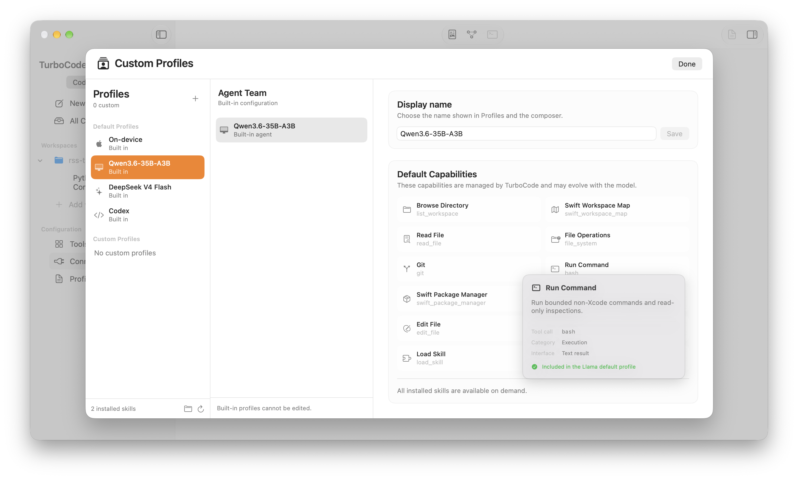

## Workspaces, tools, and safety

TurboCode includes native integrations for Swift, SwiftUI, Xcode projects,
Swift Package Manager packages, and general repository workflows. Its
structured tools cover:

- workspace and file inspection;
- compact Swift repository maps;
- revision-aware file editing;
- Xcode and Swift Package Manager builds and tests;
- compiler diagnostics and test results;
- Git status, branches, commits, remotes, and other repository operations.

The interface keeps consequential work visible. File operations outside the
active workspace require explicit approval, and destructive file or Git
operations have their own confirmation boundaries. Generated changes can be
reviewed against the real working tree before publication.

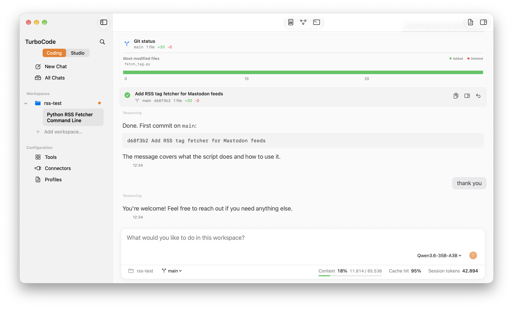

### Structured conversation output

The transcript is more than a stream of text. TurboCode renders important
results as native views so they can be inspected without losing the
conversation context:

- line-by-line change review;
- grouped Git status;
- file and workspace listings;
- build and test diagnostics;
- tool activity and plugin widgets.

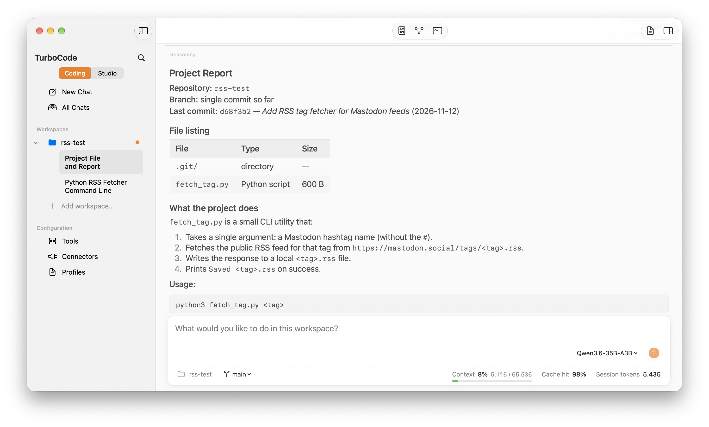

### Native macOS interface

TurboCode uses SwiftUI and AppKit for its window, sidebar, transcript,
inspector, settings, and workspace interactions. The interface follows native
macOS conventions and Apple's Human Interface Guidelines, with progressive
disclosure so tools and past sessions remain available without taking over the
main conversation.

### Tools and diagnostics

The **Tools** view makes the active runtime explicit. It shows backend
availability, context requirements, model capabilities, installed Skills, and
on-device latency, token, tool-call, and outcome statistics.

## TypeScript plugins

TypeScript plugins are optional extensions for users who want to add typed
tools or custom response widgets. A plugin is a normal Node.js project using
the `@granvalenti/turbocode-sdk`.

TurboCode retains ownership of plugin registration, workspace access,
approvals, timeouts, cancellation, process lifecycle, validation, and
presentation. Plugin processes receive value-based session snapshots; they do
not receive Swift, SwiftUI, application stores, credentials, or provider
sessions.

The SDK is bundled with the app and installed during onboarding at:

```text
~/.turbocode/sdk/@granvalenti/turbocode-sdk/
```

Plugins are validated and installed under:

```text
~/.turbocode/plugins/<plugin-id>/
```

The model can create or modify a plugin in the active workspace, build and
validate it, and reload it with `/reload` without rebuilding TurboCode. Custom
HTML widgets run in a host-owned WebView and cannot replace TurboCode's
navigation or safety controls.

See [TypeScript plugins](TurboCode/Documentation/turbocode-typescript-plugins.md)
and [`TurboCodeSDK/README.md`](TurboCodeSDK/README.md) for the workflow and
SDK reference.

## Configuration

During onboarding TurboCode creates the local configuration under
`~/.turbocode/`. The default OpenAI-compatible endpoint used by Llama is:

```text
http://127.0.0.1:8080/v1
```

Change it in `~/.turbocode/models.json` when using another local server or
port. The file contains non-sensitive model endpoints and capabilities.

Agent, execution, Skill, and Git policies live in:

```text
~/.turbocode/config.json
```

DeepSeek credentials are configured in **Settings → Providers** and stored in
the macOS Keychain. TurboCode does not require or read a `.env` file.
See [CONFIGURATION.md](CONFIGURATION.md) for the complete configuration
schema.

## Experimental capabilities

The following capability is available but remains experimental:

### On-device orchestration

The on-device model can act as the entry point, analyze a request, and
delegate complex work to a configured worker model. The result returns to the
on-device coordinator for presentation.

## Requirements and Xcode setup

- macOS 27
- Xcode 27 with the full suite installed
- Swift 6
- Node.js 24 or later for TypeScript plugins
- A Mac with Apple silicon and about 2.2 GB of free space for Studio
- A Mac capable of running Apple Foundation Models for the on-device profile
- An optional local model server or remote provider credential for other
  profiles

The full Xcode suite is required even for a standalone Swift package because
TurboCode uses Xcode project and scheme discovery, Apple SDKs, `xcrun`,
`xcodebuild`, compiler destinations, and structured `xcresult` diagnostics.
The Command Line Tools alone are not sufficient for the supported workflow.

Launch Xcode once to accept its license and install requested platform
components, then verify the active toolchain:

```shell
xcodebuild -version
xcode-select -p
```

To register TurboCode as an external ACP agent in Xcode, follow
[ACP_AGENT_SETUP.md](ACP_AGENT_SETUP.md). The app embeds the helper at
`Contents/Helpers/turbocode-acp`.

## Build from source

Clone the repository, open `TurboCode.xcodeproj`, select the **TurboCode**
scheme, and run the macOS app.

Command-line build:

```shell
xcodebuild \
  -project TurboCode.xcodeproj \
  -scheme TurboCode \
  -configuration Debug \
  build
```

Swift Package dependencies are resolved automatically by Xcode. The project
uses a local copy of [Apple Foundation Models Utilities](https://github.com/apple/foundation-models-utilities),
temporarily vendored from `1.0.0-beta3` with the obsolete
`Transcript.Segment.custom` case removed for Xcode 27 beta compatibility.
Provenance and removal instructions are documented in
`Vendor/foundation-models-utilities/README-TurboCode.md`.

Other direct dependencies include
[MarkdownUI](https://github.com/gonzalezreal/swift-markdown-ui) and
[SwiftTerm](https://github.com/migueldeicaza/SwiftTerm).

## Tests and evaluations

The deterministic release gate runs Swift Testing coverage without starting
Foundation Models:

```shell
Scripts/test-deterministic.sh
```

Model-backed golden evaluations use a separate, timeout-bounded command. They
can vary with macOS and Foundation Models changes, so they are
experimental signals rather than the deterministic release gate. See
[TESTING.md](TESTING.md) for both paths.

## Privacy and safety

- Apple on-device inference stays local.
- Local OpenAI-compatible inference stays local when a local endpoint is used.
- Remote requests are sent only to the backend selected by the user.
- Credentials are stored in the macOS Keychain, not in TurboCode's JSON files.
- File tools validate workspace paths and recheck targets before execution.
- Source edits are revision-bound and presented for review.
- Destructive file and Git operations have explicit approval boundaries.
- Diagnostics exclude prompts, generated source, file contents, and workspace
  paths.

TurboCode is software under development and should not be treated as a
security boundary. Review generated changes and Git operations before
publishing them.

## Project status

TurboCode 0.65 includes:

- Coding sessions with reviewable, revision-bound edits, repository maps,
  structured Git tools, and Xcode and Swift Package Manager builds and tests;
- Studio sessions in a managed Linux VM, with live previews, vision, an
  Artifacts library, and approval-gated export;
- a first-launch setup that finds a local model server and writes the
  configuration;
- built-in and custom profiles, Skills, workspace `AGENTS.md` instructions,
  and TypeScript plugins;
- connectors for Prassitele and Safari;
- session titles and live progress answers from the on-device model;
- Codex and DeepSeek adapters for tasks that need a frontier model.

Model behavior varies between backends and model sizes, and plugin trust and
some advanced approval flows are still evolving.

See [CHANGELOG.md](CHANGELOG.md) for the release history. For a visual
overview and the latest project notes, visit
[granvalenti.art/turbocode](https://granvalenti.art/turbocode/).

## License

TurboCode is available under the [MIT License](LICENSE).
